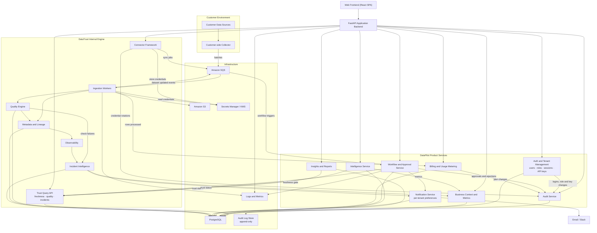

# DataPilot: target architecture

This is the planned production architecture behind the DataPilot web app. The front end in this repository is built and runs against simulated data (see [BUILD_NOTES.md](BUILD_NOTES.md)). The services below are what those simulations stand in for.

## Why the less obvious pieces exist

Each of these is something a built screen already depends on.

- **Trust Query API.** Trust pages, the Trust warnings in Insights and Intelligence, and the Automate freshness gate all need current freshness, quality and incident state. The API reads it through one interface instead of reaching into engine tables.
- **Audit Service and append-only store.** Audit Logs combines admin changes, workflow approvals and credential rotations. It is kept apart from operational logs so entries cannot be edited and can follow the tenant's retention setting (90 or 365 days).
- **Notification Service.** Workflow actions and Trust incidents are delivered by email and Slack, according to the tenant's notification preferences.
- **Secrets Manager / KMS.** Source credentials are encrypted at rest and never returned to the browser. Only the connector framework writes them and only ingestion workers read them.
- **Billing and Usage Metering.** The Usage page shows rows processed and connected sources against plan limits, so ingestion reports row counts per tenant.
- **SQS for both ingestion paths.** Connector sync jobs and collector batches share one queue, so ingestion workers scale and retry the same way for both. Ingestion also publishes "dataset updated" events, which trigger workflows.

## Where the front-end mocks plug in

| Service | Front-end code it replaces |
|---|---|
| Auth and Tenant Management | `src/features/auth/api.ts`; users, roles, sessions and API keys in `src/features/admin/store.ts` |
| Audit Service | `src/features/admin/audit.ts` |
| Billing and Usage Metering | plan and usage in `src/features/admin/store.ts` and `src/features/admin/usage.ts` |
| Business Context and Metrics, Insights and Reports | `src/features/insights/data.ts` |
| Intelligence Service | `src/features/intelligence/` |
| Workflow and Approval Service | `src/features/automate/store.ts` |
| Notification Service | notification preferences in `src/features/admin/store.ts` |
| Connector Framework | `src/features/connect/store.ts` |
| Quality, Metadata, Incidents (via Trust Query API) | `src/features/trust/store.ts` |

The Command Center has no service of its own. It reads the other modules (`src/features/command-center/signals.ts`) and will read the same APIs.

## Open decisions

- **Front-end framework.** The app is a Vite + React single-page app. An earlier version of this diagram said Next.js. Either keep the SPA or plan a migration: pages and components carry over, but routing and the app shell would be rewritten.
- **Collector path.** This diagram sends collector batches through SQS. If the collector should stream directly to ingestion workers, the retry and backpressure story needs to be decided separately.
- **Permission enforcement.** The permission matrix is enforced only on the Admin pages today. The backend should enforce it in every service.
